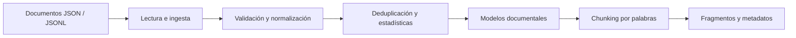
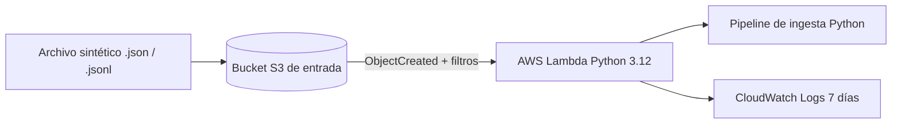

# Enterprise Knowledge AI

**Ingeniería Python para procesamiento documental y base técnica de una plataforma de conocimiento con GenAI.**

`enterprise-knowledge-ai` es un proyecto de portafolio orientado a construir, de forma incremental y verificable, un pipeline de ingesta, validación, normalización, deduplicación y fragmentación de documentos. Su siguiente etapa es ejecutar la ingesta mediante una arquitectura serverless en AWS y, posteriormente, incorporar recuperación semántica y generación aumentada por recuperación (RAG).

> **Estado del proyecto (20 de noviembre de 2026):** pipeline Python y adaptador de eventos S3 implementados y probados localmente; infraestructura AWS SAM validada y compilada; identidad de desarrollo, roles de IAM, controles de costes y bucket privado de artefactos SAM configurados en una cuenta personal. **El stack de ingesta S3 → Lambda → CloudWatch todavía NO ha sido desplegado ni probado de extremo a extremo en AWS.**

## Contenido

- [Estado y alcance](#estado-y-alcance)
- [Arquitectura](#arquitectura)
- [Funcionalidades implementadas](#funcionalidades-implementadas)
- [Estructura del repositorio](#estructura-del-repositorio)
- [Ejecución y pruebas locales](#ejecución-y-pruebas-locales)
- [Integración con AWS](#integración-con-aws)
- [Seguridad y control de costes](#seguridad-y-control-de-costes)
- [Limitaciones conocidas](#limitaciones-conocidas)
- [Hoja de ruta](#hoja-de-ruta)
- [Criterios de verificación del MVP](#criterios-de-verificación-del-mvp)

## Estado y alcance

| Área | Estado | Evidencia disponible |
| --- | --- | --- |
| Normalización, validación y modelos documentales | **Implementado** | Tests automatizados locales |
| Deduplicación y estadísticas de colecciones | **Implementado** | Tests automatizados locales |
| Lectura JSON/JSONL y procesamiento incremental | **Implementado** | Tests automatizados locales |
| Fragmentación de documentos (*chunking*) | **Implementado** | Tests automatizados locales |
| Adaptador de eventos S3 y punto de entrada Lambda | **Implementado localmente** | Pruebas con clientes simulados |
| Integración continua en GitHub Actions | **Configurada y verificada** | Matriz Python 3.12 / 3.13 |
| Empaquetado y validación de AWS SAM | **Validado localmente** | `sam validate --lint` y `sam build` |
| Autenticación AWS y controles IAM | **Configurados en el laboratorio** | IAM, MFA y AWS CLI/STS |
| Bucket S3 para artefactos de despliegue | **Creado y verificado** | Región, bloqueo público y cifrado |
| Presupuesto y alertas AWS | **Configurados** | Presupuesto y destinatario verificados |
| Stack de ingesta S3 → Lambda → CloudWatch | **Pendiente de despliegue real** | No hay ejecución cloud confirmada |
| Embeddings, vector store, retrieval, RAG y agentes | **Planificado** | Aún no implementado |

**Calidad confirmada:** último resultado local observado: **134 tests aprobados** (`pytest`). El workflow `.github/workflows/python-tests.yml` se ha ejecutado satisfactoriamente con Python 3.12 y 3.13. No se afirma un porcentaje de cobertura, un despliegue productivo ni una certificación profesional basándose en estas pruebas.

## Arquitectura

### 1. Pipeline Python implementado



El pipeline privilegia funciones con contratos claros, comprobaciones defensivas, manejo explícito de excepciones, no mutación de entradas cuando corresponde y pruebas automatizadas.

### 2. Arquitectura serverless preparada (aún no desplegada)



Esta segunda arquitectura está **declarada en `template.yaml`** y su lógica de aplicación está **probada con dobles de prueba**, pero no se debe interpretar como un sistema ya ejecutado en AWS.

El bucket de **artefactos SAM**, creado por separado, almacena paquetes para un futuro despliegue y **no recibe documentos del pipeline de negocio**.

## Funcionalidades implementadas

### Normalización y validación

- `document_normalizer.py`: `normalize_document()` y `normalize_documents()`. Valida datos de entrada y normaliza títulos, contenido y conteos de palabras sin modificar los originales.
- `document_batch_validator.py`: `validate_document_batch()` y la excepción de dominio `DocumentBatchError`. Aplica políticas de validación de lotes y puede rechazar duplicados.
- `document_models.py`: `NormalizedDocument` y `build_document_records()`. Modelo mediante `dataclass`, invariantes, inmutabilidad de campos y serialización con `to_dict()`.

### Colecciones y estadísticas

- `document_collection_processor.py`: `process_document_collection()` y `process_document_collection_with_stats()`.
- Deduplicación basada en **título y contenido normalizados**, preservando la primera aparición y el orden.
- Estadísticas `total`, `unique` y `duplicates`, sujetas al invariante `total = unique + duplicates`.

### Ingesta y fragmentación

- `document_ingestion.py`: `load_document_batch()`, `iter_jsonl_objects()` y `load_jsonl_batch()`. Lectura de JSON/JSONL, validación de formatos, iteración incremental de líneas y reutilización del pipeline.
- `document_chunking.py`: `chunk_document()` y `build_chunks()`. Estrategias `fixed` y `single`, tamaños configurables, solapamiento y metadatos de fragmentación.
- **Alcance actual del chunking:** segmentación por palabras mediante `split()`; **no** utiliza todavía tokenizadores específicos de LLM.

### Adaptador de AWS S3 y Lambda

- `s3_ingestion.py`: `extract_s3_objects()`, `load_s3_batch()` y `process_s3_event()`.
- Interpreta registros de eventos S3, decodifica claves de objetos y filtra el prefijo `incoming/` con extensiones `.json` y `.jsonl`.
- Utiliza un cliente S3 inyectable; las pruebas sustituyen AWS por clientes simulados.
- Limita las lecturas a **5 MiB por objeto**, cierra los cuerpos de respuesta y utiliza archivos temporales sin convertir claves S3 en rutas locales.
- `lambda_handler.py`: `lambda_handler(event, context)` crea el cliente de `boto3` en ejecución, delega la ingesta y registra información de procesamiento.

**Consideración operacional:** S3 puede entregar notificaciones más de una vez. El adaptador contempla el procesamiento de múltiples registros y la propagación de errores, pero **no tiene idempotencia persistente** ni una cola de reintentos/DLQ implementada.

## Estructura del repositorio

```text
enterprise-knowledge-ai/
├── .github/
│   └── workflows/
│       └── python-tests.yml
├── scripts/
│   └── prepare_lambda.py
├── tests/
│   ├── test_document_normalizer.py
│   ├── test_document_collection_processor.py
│   ├── test_document_collection_stats.py
│   ├── test_document_batch_validator.py
│   ├── test_document_models.py
│   ├── test_document_ingestion.py
│   ├── test_document_chunking.py
│   └── test_s3_ingestion.py
├── document_normalizer.py
├── document_collection_processor.py
├── document_batch_validator.py
├── document_models.py
├── document_ingestion.py
├── document_chunking.py
├── s3_ingestion.py
├── lambda_handler.py
├── template.yaml
├── requirements.txt
├── requirements-dev.txt
├── README.md
└── .gitignore
```

Los directorios `build/lambda/` y `.aws-sam/` se generan localmente y se mantienen excluidos del control de versiones.

## Ejecución y pruebas locales

### Requisitos

- Python compatible con el proyecto (runtime AWS preparado: **Python 3.12**; CI comprobada también con **Python 3.13**).
- `pip` y un entorno virtual recomendado.
- Dependencias declaradas en `requirements.txt` y `requirements-dev.txt`.
- AWS CLI v2 y AWS SAM CLI **solo** para tareas relacionadas con la infraestructura AWS.

### Instalación en Windows (Command Prompt)

Desde la raíz del repositorio:

```bat
python -m venv .venv
.venv\Scripts\activate
python -m pip install -r requirements.txt
python -m pip install -r requirements-dev.txt
```

### Ejecutar tests

```bat
python -m pytest -q
```

Última línea de resultados confirmada: `134 passed`.

Las pruebas cubren normalización, validaciones, excepciones, inmutabilidad, deduplicación, estadísticas, modelos `dataclass`, JSON/JSONL, fragmentación, lectura S3 simulada, cierre de recursos, límite de tamaño, filtrado de eventos, orquestación y el handler Lambda con dependencias simuladas.

### Preparar el artefacto Lambda y validar SAM

```bat
python scripts/prepare_lambda.py
sam validate --lint -t template.yaml --region us-east-1 --profile eka-dev
sam build
```

`scripts/prepare_lambda.py` reconstruye `build/lambda/` con **nueve archivos**: ocho módulos Python productivos y `requirements.txt`. SAM utiliza `CodeUri: build/lambda`; los tests, los workflows y la documentación no forman parte del artefacto revisado.

> **No guardar archivos manuales en `build/lambda/`:** el script recrea esa carpeta. Los comandos anteriores preparan y validan el código; **no realizan un despliegue real**.

## Integración con AWS

### Infraestructura declarada en `template.yaml`

| Recurso | Configuración preparada |
| --- | --- |
| Bucket S3 de ingesta | Nombre derivado de stack, región y cuenta; cifrado SSE-S3; bloqueo completo de acceso público |
| Notificaciones S3 | Eventos `s3:ObjectCreated:*` filtrados por `incoming/` y sufijos `.json` / `.jsonl` |
| Función Lambda | Python 3.12, 256 MiB, timeout de 30 s, concurrencia reservada de 2 |
| Permisos de ejecución | Rol IAM existente con lectura de `incoming/*` y escritura de logs |
| CloudWatch Logs | Grupo de logs dedicado con retención de 7 días |
| Outputs del stack | Nombre del bucket de entrada y nombre de la función |

La plantilla fue ajustada localmente para referenciar el rol preexistente `eka-lambda-ingestion-dev` mediante `Role`, en lugar de crear automáticamente otro rol. La política `Policies` de la función se eliminó de la versión local validada; sus privilegios residen en el rol IAM externo. Esta dependencia **debe provisionarse antes** de crear el stack.

### Recursos realmente configurados en la cuenta de laboratorio

- Cuenta personal con MFA y plan gratuito; identidad de desarrollo IAM independiente del usuario raíz.
- Perfil local `eka-dev`, región `us-east-1`, autenticación mediante `aws login` y credenciales temporales; identidad comprobada con STS.
- Roles IAM separados para la ejecución de Lambda (`eka-lambda-ingestion-dev`) y CloudFormation (`eka-cfn-execution-dev`), con políticas específicas del laboratorio.
- Políticas de desarrollo separadas para CloudFormation y para el bucket de artefactos SAM.
- Bucket **privado de artefactos de despliegue SAM** creado y verificado con los cuatro controles de acceso público activados, cifrado SSE-S3 (`AES256`) y región `us-east-1` (`LocationConstraint: null` en esa región).
- Presupuesto mensual de costes, configurado para **excluir créditos promocionales**, con dos umbrales de alerta y destinatario verificado.

**No se han verificado aún:** la creación del bucket S3 de ingesta, la función Lambda en AWS, las notificaciones efectivas, los logs de ejecuciones reales ni un stack CloudFormation completado.

### Convenciones del laboratorio

| Concepto | Ejemplo o convención |
| --- | --- |
| Región | `us-east-1` |
| Perfil CLI local | `eka-dev` |
| Stack previsto | `eka-ingestion-dev` |
| Bucket de artefactos SAM | `eka-sam-artifacts-us-east-1-<ACCOUNT_ID>` |
| Bucket de entrada previsto | `${AWS::StackName}-${AWS::Region}-${AWS::AccountId}-input` |
| Prefix de documentos | `incoming/` |

`<ACCOUNT_ID>` y los pseudoparámetros son marcadores: **nunca publicar el identificador real de cuenta, credenciales, URLs de autorización, claves ni datos personales en el repositorio**.

### Puerta de salida antes del primer despliegue

El despliegue **no es automático**. Antes de ejecutar `sam deploy` se debe:

1. Revisar las políticas efectivas del usuario y del rol de servicio de CloudFormation, los permisos de carga del bucket de artefactos y el `iam:PassRole` limitado al rol Lambda.
2. Confirmar cuenta/identidad con STS, región, nombre del stack y presupuesto/alertas.
3. Revisar la cuota de concurrencia disponible para Lambda.
4. Repetir `pytest`, preparación del artefacto, `sam validate --lint` y `sam build`.
5. Inspeccionar el *change set* de CloudFormation antes de confirmar cambios.
6. Realizar las primeras pruebas **solo con documentos sintéticos**, inspeccionar CloudWatch y registrar resultados verificables.
7. Preparar la limpieza del stack, objetos S3, roles administrados externamente y artefactos temporales.

**La configuración IAM del laboratorio se ha realizado parcialmente fuera de la plantilla SAM**. La automatización completa y reproducible de esos roles y políticas está pendiente de una siguiente iteración de infraestructura como código.

## Seguridad y control de costes

- Autenticación multifactor y separación entre la identidad raíz y la de desarrollo.
- Credenciales temporales mediante AWS CLI; no se usan *access keys* permanentes de root.
- IAM de mínimo privilegio y separación de usuario de despliegue, rol de CloudFormation y rol de ejecución Lambda.
- Buckets privados con bloqueo de acceso público y cifrado en reposo.
- Acceso de Lambda a objetos limitado al prefijo `incoming/*`.
- Retención de logs acotada y tamaño máximo de lectura por objeto.
- Presupuesto de laboratorio y alertas verificadas. **Un presupuesto alerta, pero no detiene automáticamente el consumo ni garantiza la ausencia de cargos.**
- No subir documentos de empresas, secretos, tokens, archivos `.aws/`, datos personales ni información confidencial a una cuenta de laboratorio o a GitHub.
- Toda prueba cloud debe usar archivos ficticios y un procedimiento explícito de limpieza.

## Limitaciones conocidas

- No existe todavía un flujo **S3 → Lambda → CloudWatch** desplegado y probado de extremo a extremo.
- No existe persistencia de resultados ni idempotencia persistente frente a eventos S3 duplicados.
- No hay cola SQS, DLQ ni reconciliación implementadas.
- La lectura S3 actual no es *streaming* de extremo a extremo.
- El chunking es por palabras, no por tokens de modelos LLM.
- No se han implementado embeddings, índices vectoriales, recuperación semántica, generación con LLM, RAG completo, API FastAPI ni agentes.
- No se dispone de una cifra de cobertura de tests confirmada.
- La infraestructura de identidades y permisos de AWS aún no es reproducible enteramente desde código.

## Hoja de ruta

| Etapa | Objetivo | Estado |
| --- | --- | --- |
| P0–P6 | Fundamentos Python y procesamiento documental | Completado |
| P7.1–P7.3 | Eventos S3, seguridad IAM, clientes simulados y orquestación | Completado |
| P7.4 · Desarrollo local | Lambda, SAM, empaquetado y pruebas | Completado |
| P7.4 · Laboratorio AWS | Cuenta, MFA, IAM, CLI, presupuesto y artefactos SAM | Configurado |
| P7.4 · Primer despliegue | Validar permisos, desplegar stack, probar ingesta y limpiar | Pendiente |
| Siguiente | Persistencia de resultados e idempotencia | Planificado |
| Siguiente | Reintentos controlados, SQS/DLQ y observabilidad | Planificado |
| Siguiente | Embeddings, almacenamiento vectorial y retrieval semántico | Planificado |
| Siguiente | Pipeline RAG, evaluación y servicio de consulta | Planificado |
| Futuro | API, agentes/herramientas y automatización IaC/CI-CD | Planificado |

El uso futuro de servicios como DynamoDB, SQS, EventBridge, Bedrock o Step Functions se decidirá a partir de requisitos concretos; su inclusión en esta hoja de ruta **no implica que estén desplegados**.

## Criterios de verificación del MVP

- [x] Pipeline Python y adaptador S3 probados localmente.
- [x] 134 tests aprobados en el último control local.
- [x] CI de Python 3.12 y 3.13 verificada.
- [x] `sam validate --lint` y `sam build` completados.
- [x] Acceso AWS con MFA y perfil CLI temporal comprobado.
- [x] Roles de Lambda y CloudFormation configurados en el laboratorio.
- [x] Presupuesto y alertas con destinatario verificado.
- [x] Bucket privado de artefactos SAM creado y validado.
- [ ] Permisos efectivos y paquete del despliegue revisados de extremo a extremo.
- [ ] *Change set* revisado y stack CloudFormation desplegado.
- [ ] Bucket de entrada y Lambda creados mediante la plantilla.
- [ ] Notificaciones S3 y logs CloudWatch verificados en AWS.
- [ ] Archivo sintético procesado correctamente con estadísticas comprobadas.
- [ ] Limpieza y eliminación de recursos del laboratorio comprobadas.

---

**Principio del proyecto:** documentar únicamente capacidades implementadas y comportamientos comprobados. La evolución hacia GenAI/RAG se basará en incrementos pequeños, tests, seguridad, trazabilidad y despliegues reproducibles.
